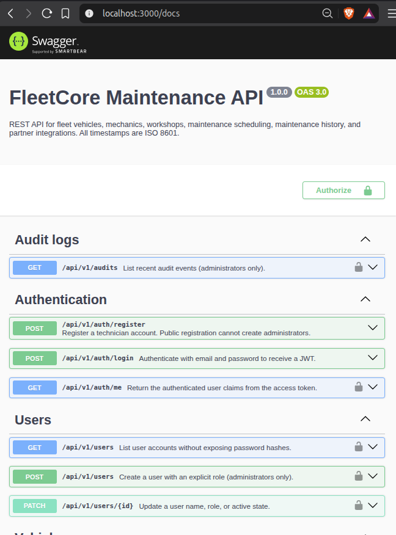
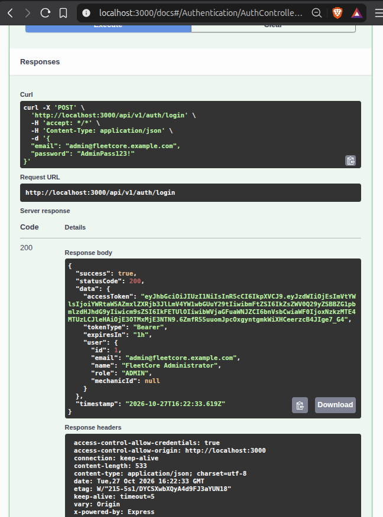
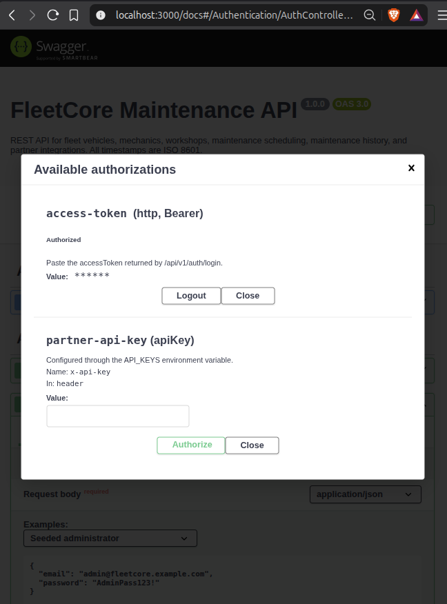
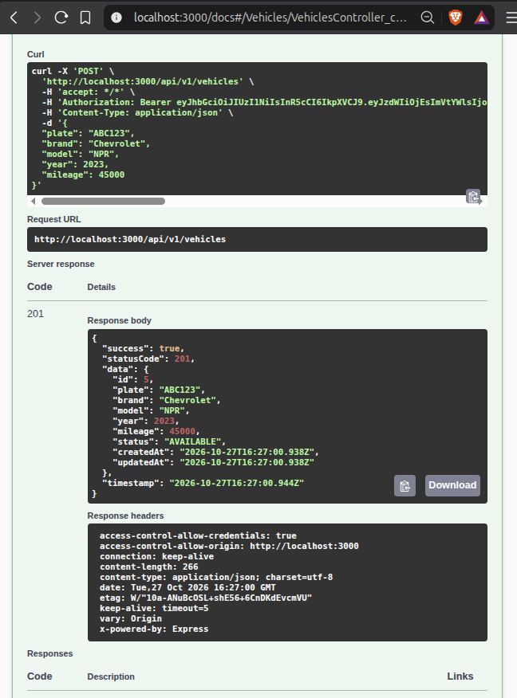
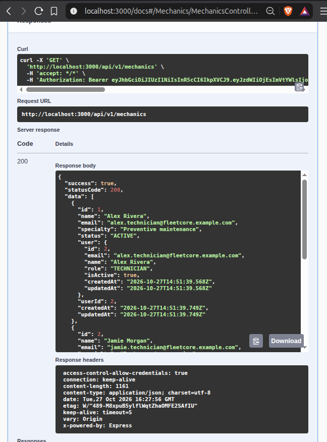
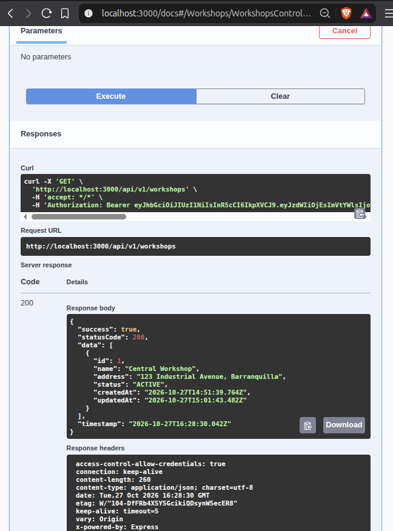
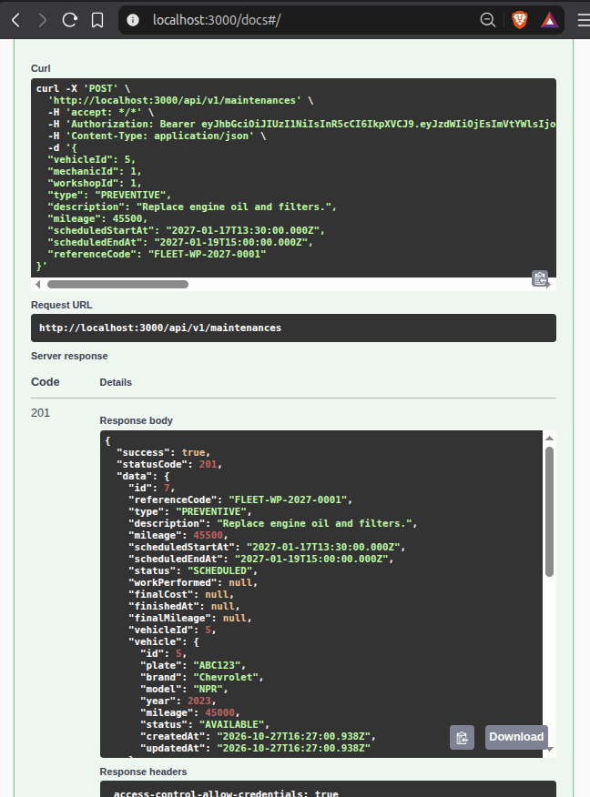
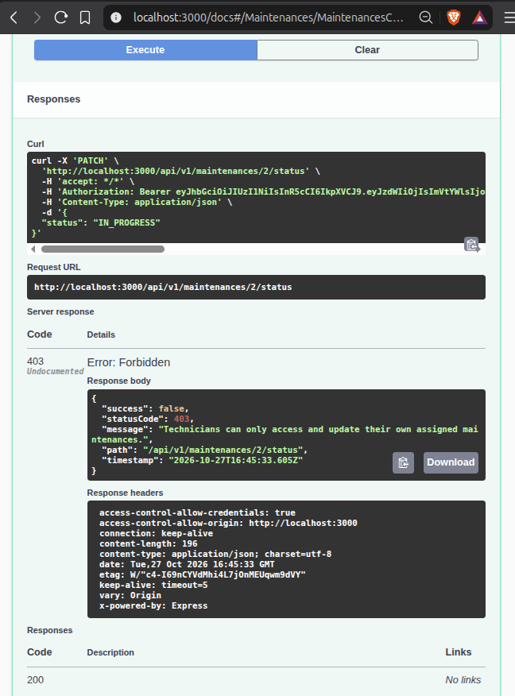
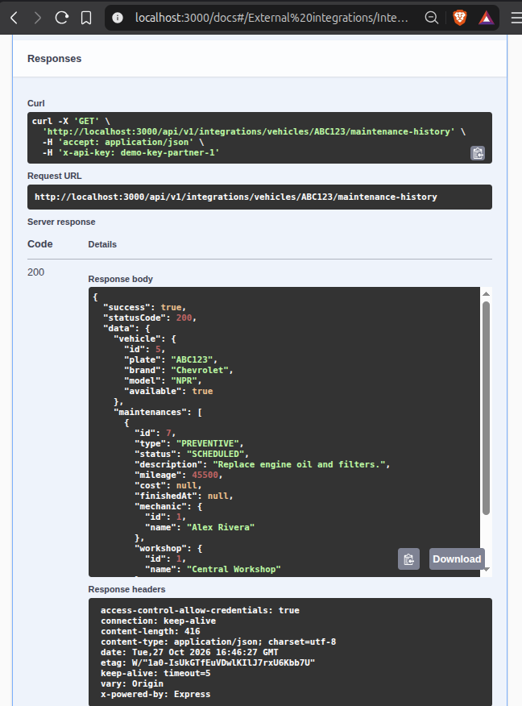

# FleetCore API — Evidence of Functionality

- [ ] **1. Swagger API Documentation**
  
  Evidence of API documentation and endpoint organization by module.
  
  

- [ ] **2. JWT User Authentication**
  
  Evidence of a successful login and JWT authentication response.
  
  

- [ ] **3. Bearer Token Authorization**
  
  Evidence of authorization configuration for protected endpoints.
  
  

- [ ] **4. Vehicle Management**
  
  Evidence of a successful vehicle creation or retrieval operation.
  
  

- [ ] **5. Mechanics**
  
  Evidence of getting mechanic
  
  

- [ ] **5. Workshops**
  
  Evidence of getting all workshops
  
  

- [ ] **6. Maintenance Creation**
  
  Evidence of successful maintenance creation, including the initial `SCHEDULED` status and associated records.
  
  

- [ ] **7. Role-Based Access Control**
  
  Evidence of restricted access when a mechanic tries to change something that doesn't belong to they
  
  

- [ ] **8. API Key Integration**
  
  Evidence of a successful integration request using the `x-api-key` header.
  
  

